# Installation and User Guide: APRS iGate on a Raspberry Pi Zero 2W

*Version of November 22, 2026 · Project: https://github.com/banshee1971/iGate-APRS-avec-un-Raspberry-Pi-Zero-2W*

Version française : [GUIDE.fr.md](GUIDE.fr.md)

## Overview

This guide explains how to build a receive-only APRS iGate with a Raspberry Pi Zero 2W and an RTL-SDR dongle. The iGate listens to the APRS frequency, decodes the packets it hears and forwards them to the APRS-IS network, where they show up on aprs.fi.

The iGate also provides a local web interface:

- the list of received packets, decoded in plain language (position, distance, weather, messages, radio model);
- a map of the stations heard, which also works without Internet;
- a password-protected administration area to configure the station, the radio and the network, and to monitor the system.

The interface is bilingual French and English: an FR | EN switch sits at the top of every page.

## Hardware

| Item | Notes |
|---|---|
| Raspberry Pi Zero 2W | Preferably the model with the GPIO header already soldered (Zero 2 WH). Otherwise the header is sold separately and must be soldered. |
| microSD card | 16 GB minimum, 32 GB recommended. |
| Heatsink | Geekworm C296, compatible with the PiSugar 3. |
| RTL-SDR dongle (RTL2832U chip) | An RTL-SDR Blog V3 is enough for an APRS iGate. |
| Micro-USB to USB adapter cable | To connect the RTL-SDR dongle to the Pi Zero. |
| VHF antenna | Tuned for 144.390 MHz (North America) or 144.800 MHz (Europe). |
| USB power supply | 5 V, 2.5 A minimum. |
| Network | Wi-Fi, or Ethernet with an adapter (see below). |

Options:

- **Uninterruptible power**: a PiSugar 3 (see Appendix A).
- **Wired network**: a small USB hub with an RJ45 port. Choose a low-power model.
- **PoE**: if you don't use a PiSugar 3, several PoE add-on boards (HATs) mount under the Pi Zero 2W.

## What you need to know

To follow this guide, you should know how to:

- download and install software on your computer;
- log in to your router, find a device's IP address and reserve a fixed address for it;
- select, copy and paste text.

## Prepare the microSD card

1. Download **Raspberry Pi Imager** from the Raspberry Pi website and install it.
2. Insert the microSD card into your computer and start Raspberry Pi Imager.
3. **Device**: choose *Raspberry Pi Zero 2 W*.
4. **Operating system**: open *Raspberry Pi OS (other)*, then choose *Raspberry Pi OS Lite (64-bit)*, Trixie release dated 2025-12-04 or newer. Make sure you pick the *Lite* version, without a desktop.
5. **Storage**: choose your microSD card.
6. Customize the settings:
   - **Hostname**: `aprs-igate`;
   - **Time zone**: choose your city (in Quebec, *America/Toronto* works if Montreal isn't listed);
   - **Username**: `pi`, in lowercase. The guide and the scripts assume this name; another name would require adjustments. Choose any password you like;
   - **Wi-Fi**: enter your network name and password so you can reach the Pi without a screen or keyboard;
   - **SSH**: enable it. You need it for the rest of this guide;
   - **Raspberry Pi Connect** (optional): lets you reach the Pi remotely with Raspberry Pi's free tool.
7. Click **Write** and wait for it to finish.
8. Insert the card into the Pi, connect the RTL-SDR dongle and the antenna, then the power supply. The first boot takes a few minutes.

In your router, find the IP address given to the Pi and reserve it so it doesn't change.

## Connect to the Pi over SSH

**macOS or Linux**: open a terminal and type:

```
ssh pi@aprs-igate.local
```

If the name isn't found, replace `aprs-igate.local` with the Pi's IP address.

**Windows**: download and start PuTTY (https://putty.org). Enter `aprs-igate.local` or the Pi's IP address, click *Open*, then log in with the user `pi` and your password.

A few tips for what follows:

- in PuTTY, a right-click pastes the copied text;
- in the `nano` editor, `Ctrl+O` saves and `Ctrl+X` exits.

## Install the iGate

1. Update the system:

   ```
   sudo apt update && sudo apt upgrade -y
   ```

2. Download the project and start the installation:

   ```
   sudo apt install -y git
   git clone https://github.com/banshee1971/iGate-APRS-avec-un-Raspberry-Pi-Zero-2W.git
   cd iGate-APRS-avec-un-Raspberry-Pi-Zero-2W
   sudo ./install.sh
   ```

3. During the installation, the script asks for an **administrator username and password**. They protect the Configuration area; the rest of the interface is open to everyone.
4. When it finishes, reboot the Pi if the script asks you to:

   ```
   sudo reboot
   ```

5. Open a browser at http://aprs-igate.local (or the Pi's IP address).

**Updating later**: connect over SSH again and type:

```
cd ~/iGate-APRS-avec-un-Raspberry-Pi-Zero-2W
git pull
sudo ./install.sh --skip-upgrade
```

Your settings, administrator account and packets are kept.

## The public interface

### Packets tab

The list of all received packets, decoded in plain language: position with distance and bearing from the iGate, speed, altitude, weather, messages, objects and radio model. Each station's APRS icon is shown, and the *direct* or *via* label tells you whether the packet was relayed by a digipeater. A link opens the station on the map.

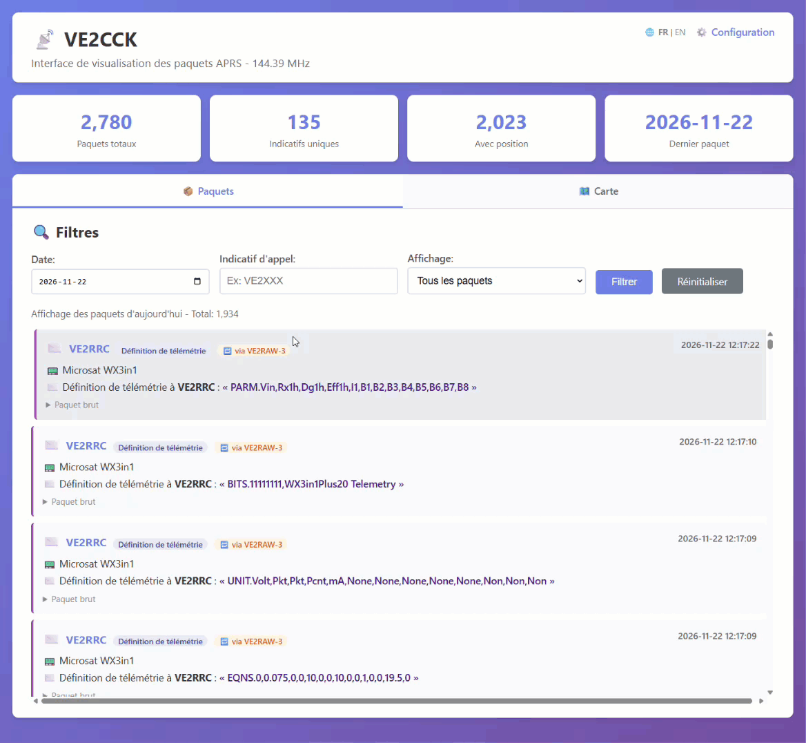

### Map tab

An interactive OpenStreetMap map of the stations that sent their position. The period filter shows the last hour, the last 6, 12, 24 (default) or 48 hours, or the last 7 days.

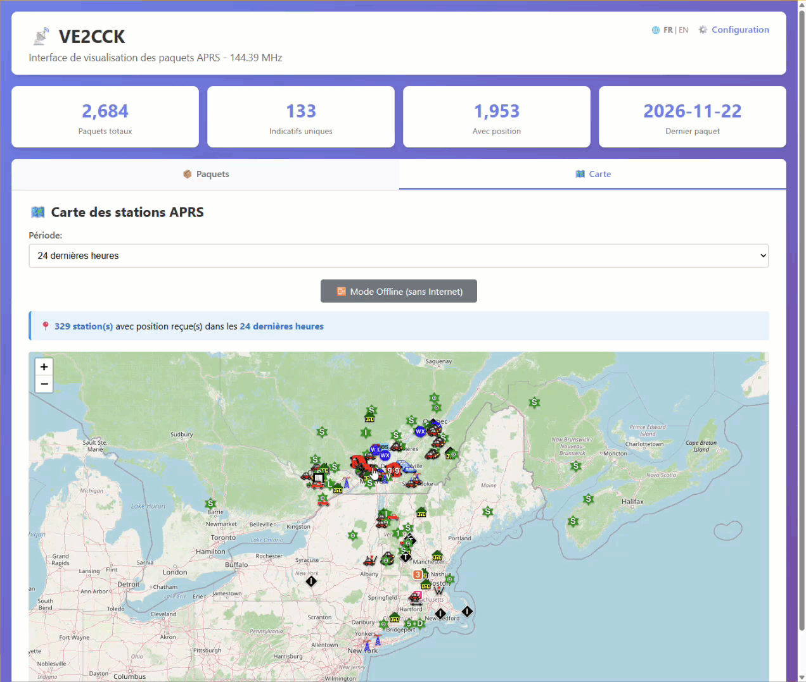

**Offline mode**: without Internet, the map automatically switches to the tiles already stored on the Pi. The *Offline mode (no Internet)* button opens that version of the map directly. Areas you have already viewed, or pre-downloaded from the Configuration tab, remain available.

## Open the administration area

1. Click **Settings** at the top right of the page.

   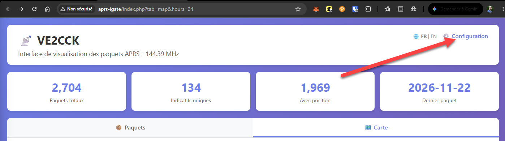

2. Enter the username and password you chose during the installation.

   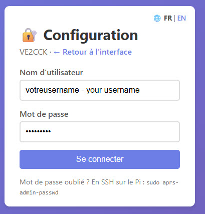

Forgot your password? Over SSH on the Pi, type `sudo aprs-admin-passwd`.

## The administration tabs

The screenshots below show the French interface; the English interface has the same layout.

### Configuration

**System status**: the state of the services (iGate, database, web server, settings application), the model of the detected SDR dongle, the space used by the map cache and today's packet count. A badly connected SDR dongle shows up here in red.

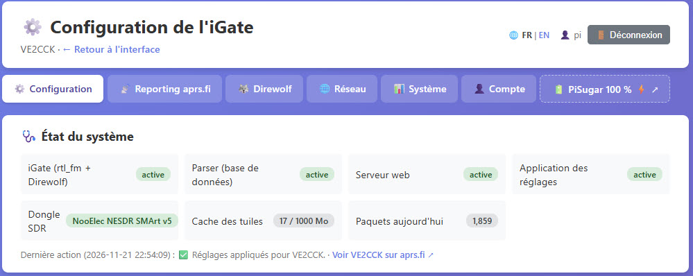

**Position and beacon**: click the map where your iGate is located; the latitude and longitude fill in. This position is sent to APRS-IS (and therefore aprs.fi) when *Beacon the iGate position to APRS-IS* is checked. You also set the beacon interval and comment.

**Web page display**: the default interface language, the title and subtitle visitors see, and the default period shown on the map.

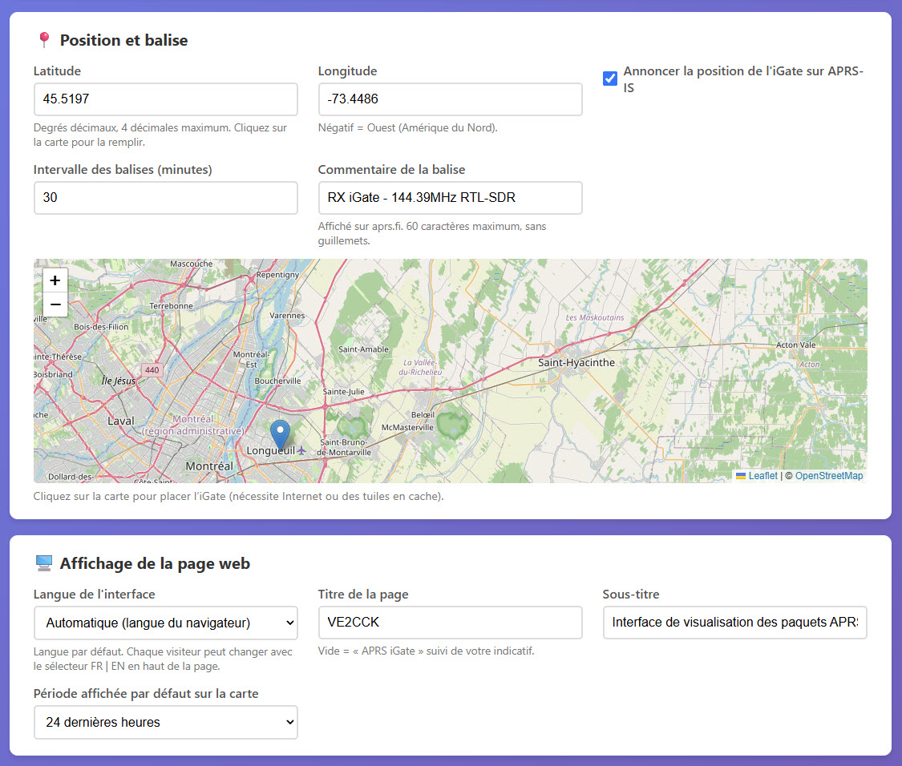

The rest of the page contains:

- **Hardware**: check the box if the RTL-SDR dongle is on a USB hub powered by the Pi. The Pi then supplies more current on its USB ports (reboot required). A USB hub with its own power supply remains the most reliable solution;
- **Map and tile cache**: the maximum cache size, how long tiles are kept and the area to pre-download;
- **Actions**: restart the services, back up, copy backups to a USB drive, pre-download or clear the tiles, reboot the Pi;
- **Recent actions log**: the details of every operation.

Click **Save and apply** to apply your changes.

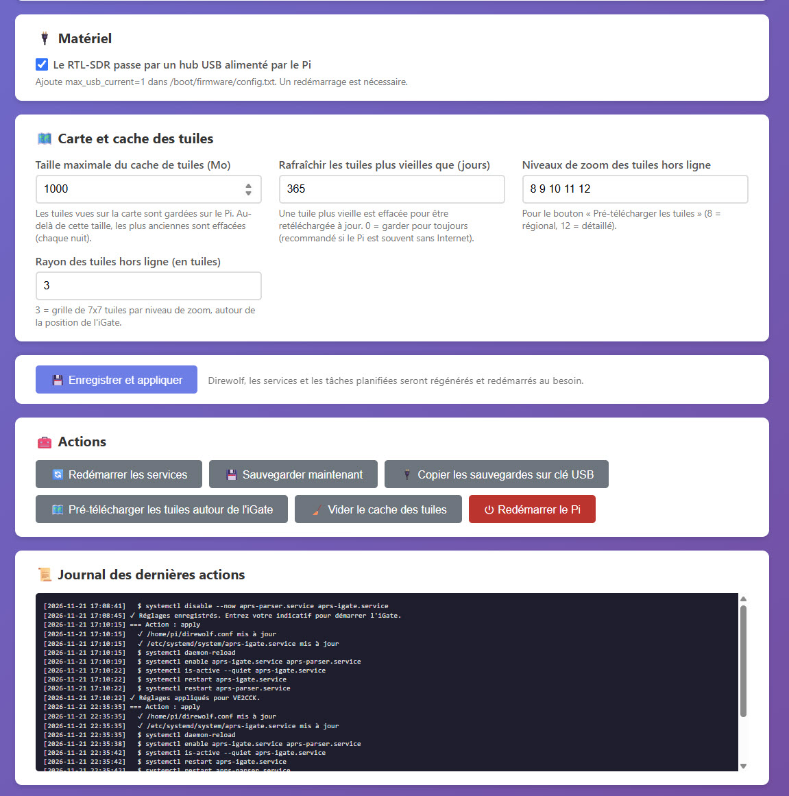

### aprs.fi reporting

1. Enter your **callsign**, without SSID.
2. Choose the **SSID**, that is, the station type; the matching icon is shown.
3. The **APRS-IS passcode** is calculated automatically from your callsign.
4. Choose the nearest **APRS-IS server** from the list.
5. Click **Save and apply**.

The **Enable / Disable** button turns forwarding to aprs.fi on or off at any time. The *Last successful report* section confirms the connection to the server, that the passcode was accepted and when the last packet was relayed. With an aprs.fi API key (optional), the page also shows what aprs.fi actually received from your station.

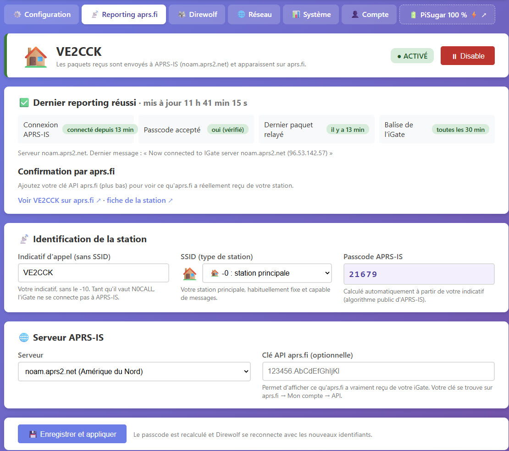

### Direwolf

Direwolf is the software that decodes the APRS audio signal. This tab lets you check that it works properly:

- **Live signal**: a needle meter that rises when a packet is received, with a two-minute history;
- **Audio level and decoded packets**: tell you whether reception is set up correctly;
- **Direwolf log**: live decoding activity;
- **Radio (RTL-SDR)**: the frequency (APRS frequencies for the different regions of the world are listed), the gain and the dongle options.

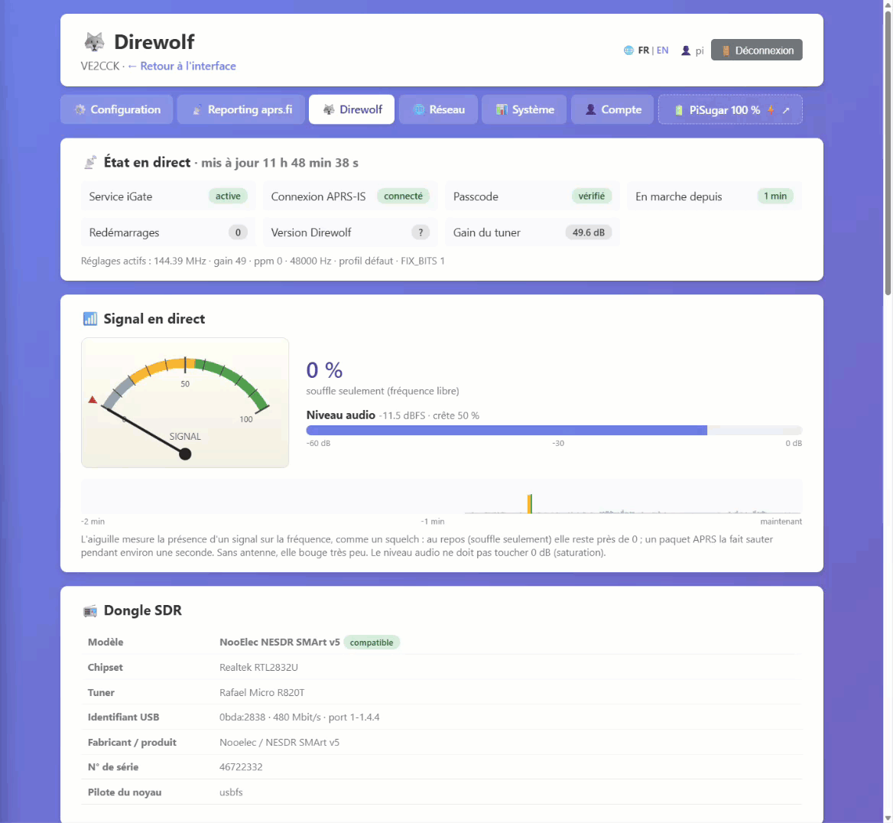

**Find the best gain**: the test listens for one minute at each gain value and counts the decoded packets. It takes about 6 minutes, during which the iGate is stopped. Run it when there is traffic. When it finishes, click **Use** next to the best result, then **Save and apply**, then **Restart Direwolf**.

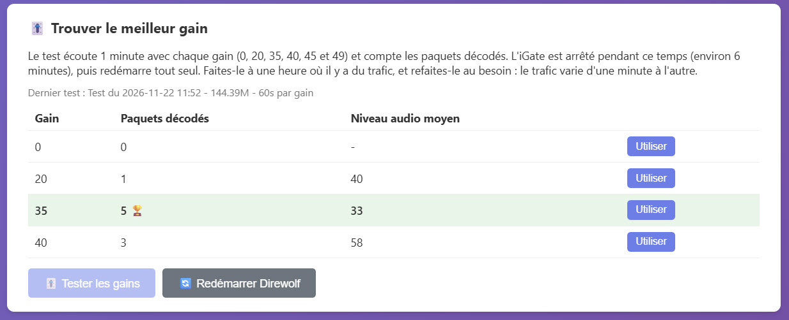

### Network

This tab shows the state of the network interfaces and manages saved **network profiles**.

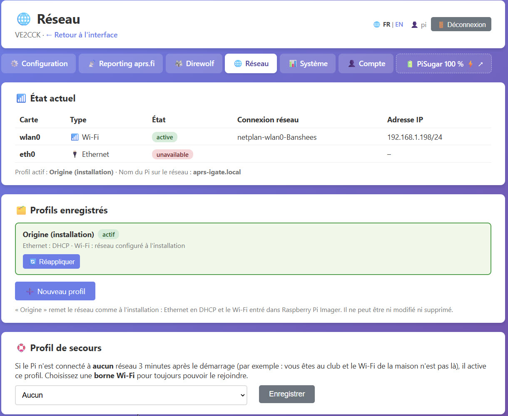

- The **Original** profile is the network configured in Raspberry Pi Imager. It cannot be edited or deleted, and always lets you return to the starting configuration.
- **New profile** lets you create, for example, a *Club presentation* profile where the Pi becomes a **Wi-Fi hotspot** that visitors join. The interface is then available at http://10.42.0.1. Without an Ethernet cable connected to the Internet, the iGate keeps receiving and displaying packets locally but cannot forward them to aprs.fi.
- After activating a profile, you have **5 minutes** to click *Keep this configuration* from the new network. Otherwise the Pi automatically returns to the previous profile.
- The **Fallback profile** is activated when the Pi has no network connection 3 minutes after booting. Choose a Wi-Fi hotspot so you can always reach the Pi.

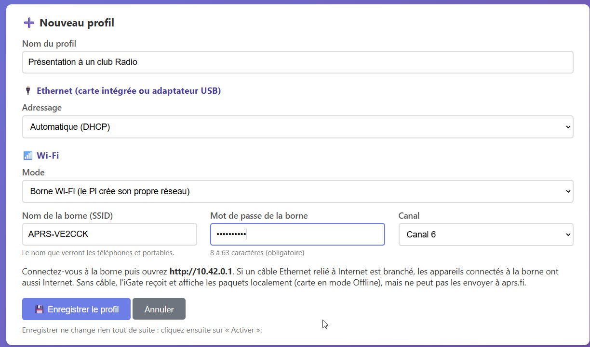

### System

Usage figures for the Raspberry Pi: processor, memory, disk space, temperature and processes. They show that the Pi Zero 2W is more than enough for this project.

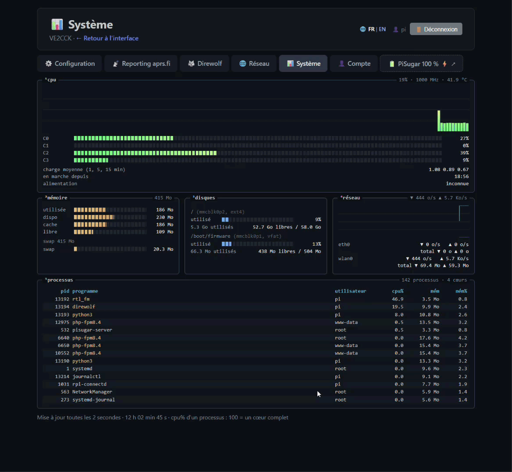

### Account

To change the administrator username and password.

### PiSugar

This tab only appears when the PiSugar software is installed and detected. It opens the PiSugar interface directly (battery level, charging); there is no other integration with the iGate.

## Appendix A: PiSugar 3

The PiSugar 3 is a battery that mounts under the Raspberry Pi and keeps it running during a power outage.

### Install the software

Prerequisites:

- the PiSugar 3 is attached to the Raspberry Pi;
- the Pi is connected to the Internet;
- the I2C interface is enabled: `sudo raspi-config`, then *Interface Options*, *I2C*, *Yes*.

Installation:

```
wget https://cdn.pisugar.com/release/pisugar-power-manager.sh
bash pisugar-power-manager.sh -c release
```

The battery management interface is then available at http://pi-address:8421, and through the PiSugar tab of the administration area.

### Update the firmware

Before you start, fully charge the battery. The script stops the `pisugar-server` service itself during the update.

```
curl https://cdn.pisugar.com/release/PiSugarUpdate.sh | sudo bash
```

Confirm if the script asks you to, then wait until it finishes: it updates the firmware and restarts the service.

### Powering on

Accidental-press protection is enabled by default: to power on, press the power button briefly, then press and hold it. The small round button on the board resets the hardware; it is not a power button.

The full description of the board (buttons, pads, connectors) is in the official documentation: https://github.com/PiSugar/PiSugar/wiki/PiSugar-3-Series

## Appendix B: transfer files with WinSCP (Windows)

WinSCP copies files between your PC and the Pi, for example to retrieve a backup.

1. Download WinSCP (https://winscp.net) and install it.
2. When it starts, choose the SFTP protocol, enter `aprs-igate.local` (or the Pi's IP address), the user `pi` and your password, then click *Login*.
3. Your PC is shown on the left and the Raspberry Pi on the right. Drag files from one side to the other.

## Appendix C: troubleshooting

| Problem | Solution |
|---|---|
| Forgot the administrator password | Over SSH: `sudo aprs-admin-passwd` |
| SDR dongle missing in System status | Check the micro-USB adapter cable. If you use a USB hub, prefer a powered one. |
| No packets decoded | Check the antenna and the frequency in the Direwolf tab, then run the gain test. |
| The station doesn't appear on aprs.fi | Check the callsign and the *Last successful report* section of the Reporting tab. |
| Pi unreachable after a network change | Wait 5 minutes: without confirmation, the Pi returns to the previous profile. |
| "Welcome to nginx" page | Run `sudo ./install.sh --skip-upgrade` again in the project folder. |
