# Guide d'installation et d'utilisation : iGate APRS sur Raspberry Pi Zero 2W

*Version du 22 novembre 2026 · Projet : https://github.com/banshee1971/iGate-APRS-avec-un-Raspberry-Pi-Zero-2W*

English version: [GUIDE.en.md](GUIDE.en.md)

## Présentation

Ce guide explique comment monter un iGate APRS en réception seulement avec un Raspberry Pi Zero 2W et une clé RTL-SDR. L'iGate écoute la fréquence APRS, décode les paquets reçus et les transmet au réseau APRS-IS, où ils deviennent visibles sur aprs.fi.

L'iGate offre aussi une interface web locale :

- la liste des paquets reçus, décodés en clair (position, distance, météo, messages, type de radio) ;
- une carte des stations entendues, qui fonctionne aussi sans Internet ;
- une section d'administration protégée par mot de passe pour régler la station, la radio, le réseau et suivre l'état du système.

L'interface est bilingue français et anglais : un sélecteur FR | EN se trouve en haut de chaque page.

## Matériel requis

| Élément | Remarques |
|---|---|
| Raspberry Pi Zero 2W | Choisissez de préférence le modèle avec le connecteur GPIO déjà soudé (Zero 2 WH). Sinon, le connecteur s'achète et se soude séparément. |
| Carte microSD | 16 Go minimum, 32 Go recommandé. |
| Dissipateur thermique | Geekworm C296, compatible avec le PiSugar 3. |
| Clé RTL-SDR (puce RTL2832U) | Une RTL-SDR Blog V3 suffit pour un iGate APRS. |
| Câble adaptateur micro-USB vers USB | Pour brancher la clé RTL-SDR sur le Pi Zero. |
| Antenne VHF | Accordée sur 144,390 MHz (Amérique du Nord) ou 144,800 MHz (Europe). |
| Alimentation USB | 5 V, 2,5 A minimum. |
| Réseau | Wi-Fi, ou câble Ethernet avec un adaptateur (voir ci-dessous). |

Options :

- **Alimentation sans coupure** : un PiSugar 3 (voir l'annexe A).
- **Réseau filaire** : un petit concentrateur USB avec prise RJ45. Choisissez un modèle qui consomme peu.
- **PoE** : si vous n'utilisez pas de PiSugar 3, plusieurs cartes d'extension (HAT) PoE se fixent sous le Pi Zero 2W.

## Connaissances préalables

Pour suivre ce guide, vous devez savoir :

- télécharger et installer un logiciel sur votre ordinateur ;
- vous connecter à l'interface de votre routeur, y trouver l'adresse IP d'un appareil et lui réserver une adresse fixe ;
- sélectionner, copier et coller du texte.

## Préparer la carte microSD

1. Téléchargez **Raspberry Pi Imager** sur le site de Raspberry Pi et installez-le.
2. Insérez la carte microSD dans votre ordinateur, puis lancez Raspberry Pi Imager.
3. **Appareil** : choisissez *Raspberry Pi Zero 2 W*.
4. **Système d'exploitation** : ouvrez *Raspberry Pi OS (other)*, puis choisissez *Raspberry Pi OS Lite (64-bit)*, version Trixie du 2025-12-04 ou plus récente. Prenez bien la version *Lite*, sans interface graphique.
5. **Stockage** : choisissez votre carte microSD.
6. Personnalisez les réglages :
   - **Nom d'hôte** : `aprs-igate` ;
   - **Fuseau horaire** : choisissez votre ville (au Québec, *America/Toronto* convient si Montréal n'est pas proposé) ;
   - **Nom d'utilisateur** : `pi`, en minuscules. Le guide et les scripts supposent ce nom ; un autre nom demanderait des ajustements. Choisissez le mot de passe que vous voulez ;
   - **Wi-Fi** : entrez le nom et le mot de passe de votre réseau, pour pouvoir joindre le Pi sans écran ni clavier ;
   - **SSH** : activez-le. Il est nécessaire pour toute la suite du guide ;
   - **Raspberry Pi Connect** (facultatif) : permet d'accéder au Pi à distance avec l'outil gratuit de Raspberry Pi.
7. Cliquez sur **Écrire** et attendez la fin de l'opération.
8. Insérez la carte dans le Pi, branchez la clé RTL-SDR et l'antenne, puis l'alimentation. Le premier démarrage prend quelques minutes.

Dans votre routeur, repérez l'adresse IP attribuée au Pi et réservez-la, pour qu'elle ne change pas.

## Se connecter au Pi par SSH

**macOS ou Linux** : ouvrez un terminal et tapez :

```
ssh pi@aprs-igate.local
```

Si le nom n'est pas reconnu, remplacez `aprs-igate.local` par l'adresse IP du Pi.

**Windows** : téléchargez et lancez PuTTY (https://putty.org). Entrez le nom `aprs-igate.local` ou l'adresse IP du Pi, cliquez sur *Open*, puis connectez-vous avec l'utilisateur `pi` et votre mot de passe.

Quelques repères pour la suite :

- dans PuTTY, un clic droit colle le texte copié ;
- dans l'éditeur `nano`, `Ctrl+O` enregistre et `Ctrl+X` quitte.

## Installer l'iGate

1. Mettez le système à jour :

   ```
   sudo apt update && sudo apt upgrade -y
   ```

2. Téléchargez le projet et lancez l'installation :

   ```
   sudo apt install -y git
   git clone https://github.com/banshee1971/iGate-APRS-avec-un-Raspberry-Pi-Zero-2W.git
   cd iGate-APRS-avec-un-Raspberry-Pi-Zero-2W
   sudo ./install.sh
   ```

3. Pendant l'installation, le script vous demande un **nom d'utilisateur et un mot de passe administrateur**. Ils protègent la section Configuration ; le reste de l'interface est accessible à tous.
4. À la fin, redémarrez le Pi si le script vous le demande :

   ```
   sudo reboot
   ```

5. Ouvrez un navigateur sur http://aprs-igate.local (ou l'adresse IP du Pi).

**Mettre à jour plus tard** : reconnectez-vous en SSH et tapez :

```
cd ~/iGate-APRS-avec-un-Raspberry-Pi-Zero-2W
git pull
sudo ./install.sh --skip-upgrade
```

Vos réglages, votre compte administrateur et vos paquets sont conservés.

## L'interface publique

### Onglet Paquets

La liste de tous les paquets reçus, décodés en clair : position avec distance et direction depuis l'iGate, vitesse, altitude, météo, messages, objets et type de radio. L'icône APRS de chaque station s'affiche, et l'indication *direct* ou *via* montre si le paquet a été relayé par un digipeater. Un lien ouvre la station sur la carte.

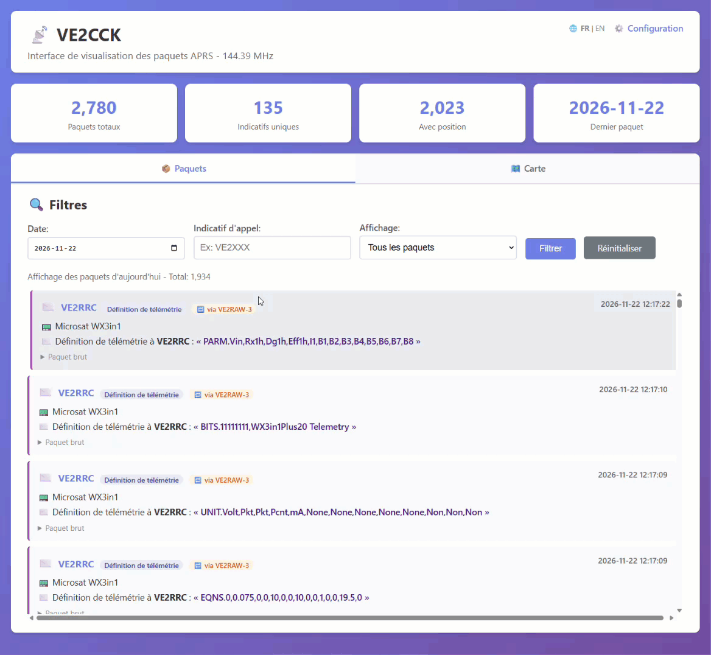

### Onglet Carte

Une carte OpenStreetMap interactive des stations qui ont envoyé leur position. Le filtre de période permet d'afficher la dernière heure, les 6, 12, 24 (par défaut) ou 48 dernières heures, ou les 7 derniers jours.

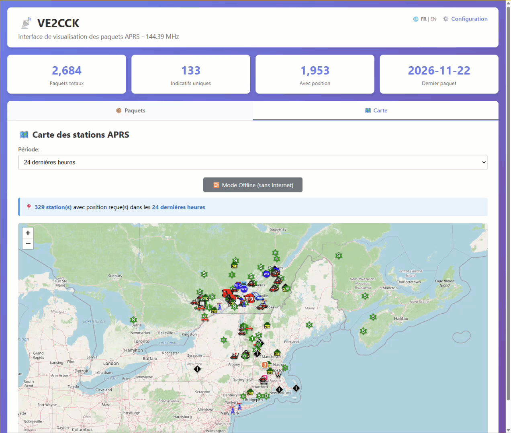

**Mode hors ligne** : sans Internet, la carte bascule automatiquement sur les tuiles déjà enregistrées sur le Pi. Le bouton *Mode Offline (sans Internet)* ouvre directement cette version de la carte. Les zones que vous avez déjà consultées, ou pré-téléchargées depuis la Configuration, restent affichées.

## Accéder à la configuration

1. Cliquez sur **Configuration** en haut à droite de la page.

   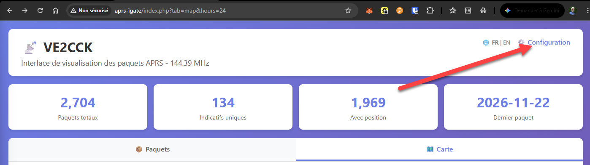

2. Entrez le nom d'utilisateur et le mot de passe choisis pendant l'installation.

   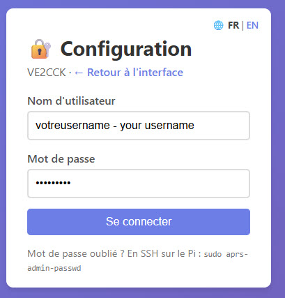

Mot de passe oublié : en SSH sur le Pi, tapez `sudo aprs-admin-passwd`.

## Les onglets d'administration

### Configuration

**État du système** : l'état des services (iGate, base de données, serveur web, application des réglages), le modèle de la clé SDR détectée, l'espace utilisé par le cache de la carte et le nombre de paquets du jour. Une clé SDR mal branchée apparaît ici en rouge.

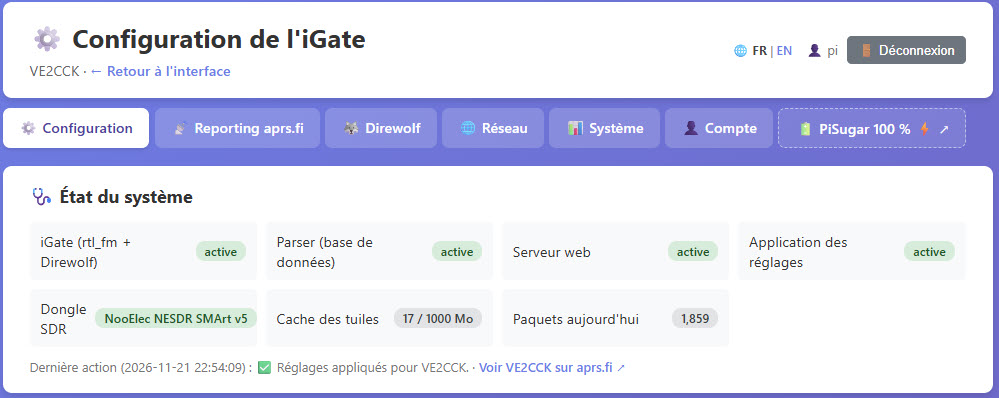

**Position et balise** : cliquez sur la carte à l'endroit où se trouve votre iGate ; la latitude et la longitude se remplissent. Cette position est annoncée sur APRS-IS (et donc sur aprs.fi) si la case *Annoncer la position de l'iGate* est cochée. Vous réglez aussi l'intervalle et le commentaire de la balise.

**Affichage de la page web** : la langue par défaut de l'interface, le titre et le sous-titre vus par les visiteurs, et la période affichée par défaut sur la carte.

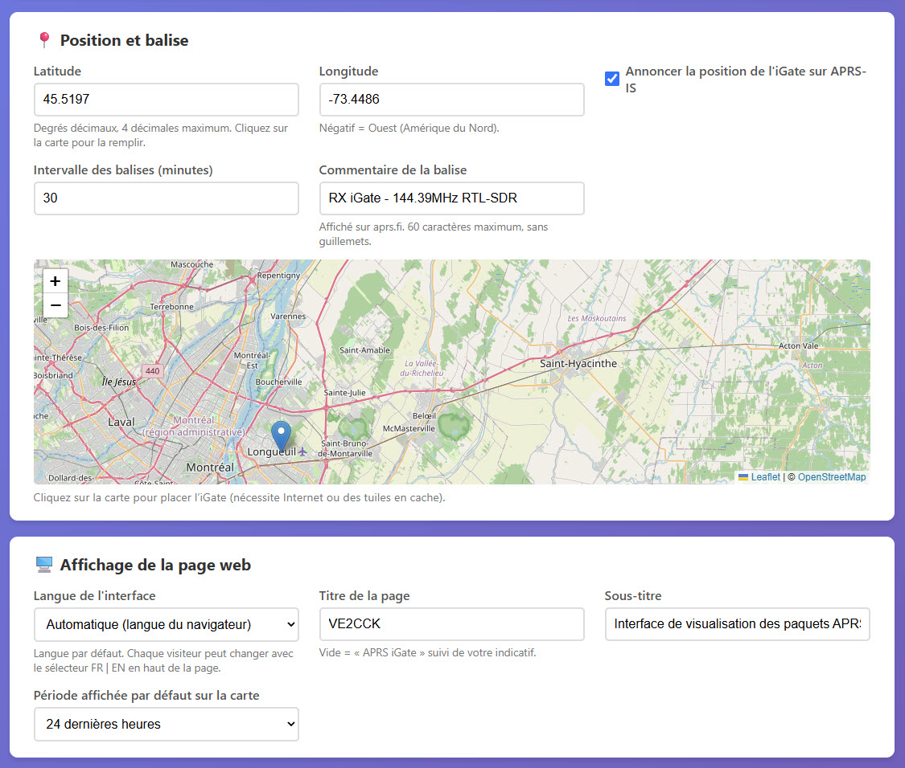

La suite de la page regroupe :

- **Matériel** : cochez la case si la clé RTL-SDR passe par un concentrateur USB alimenté par le Pi. Le Pi fournit alors plus de courant sur ses ports USB (redémarrage nécessaire). Un concentrateur USB avec sa propre alimentation reste la solution la plus fiable ;
- **Carte et cache des tuiles** : la taille maximale du cache, la durée de conservation des tuiles et la zone à pré-télécharger ;
- **Actions** : redémarrer les services, sauvegarder, copier les sauvegardes sur une clé USB, pré-télécharger ou vider les tuiles, redémarrer le Pi ;
- **Journal des dernières actions** : le détail de chaque opération effectuée.

Cliquez sur **Enregistrer et appliquer** pour appliquer vos changements.

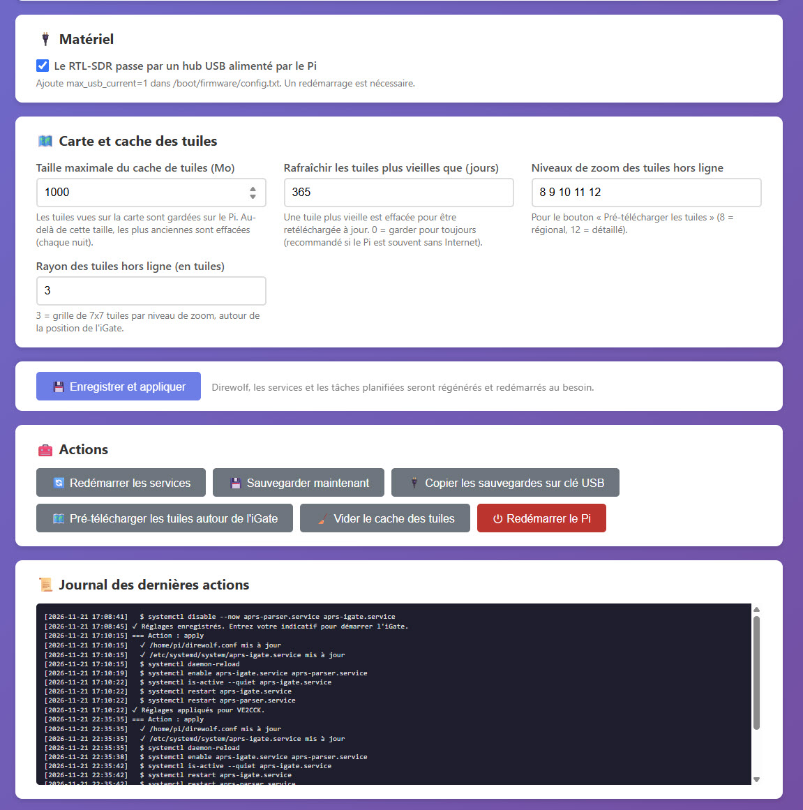

### Reporting aprs.fi

1. Entrez votre **indicatif**, sans SSID.
2. Choisissez le **SSID**, c'est-à-dire le type de station ; l'icône correspondante s'affiche.
3. Le **passcode APRS-IS** est calculé automatiquement à partir de votre indicatif.
4. Choisissez le **serveur APRS-IS** le plus proche dans la liste.
5. Cliquez sur **Enregistrer et appliquer**.

Le bouton **Enable / Disable** active ou suspend l'envoi vers aprs.fi à tout moment. La section *Dernier reporting réussi* confirme la connexion au serveur, l'acceptation du passcode et l'heure du dernier paquet relayé. Avec une clé API aprs.fi (facultative), la page affiche aussi ce qu'aprs.fi a réellement reçu de votre station.

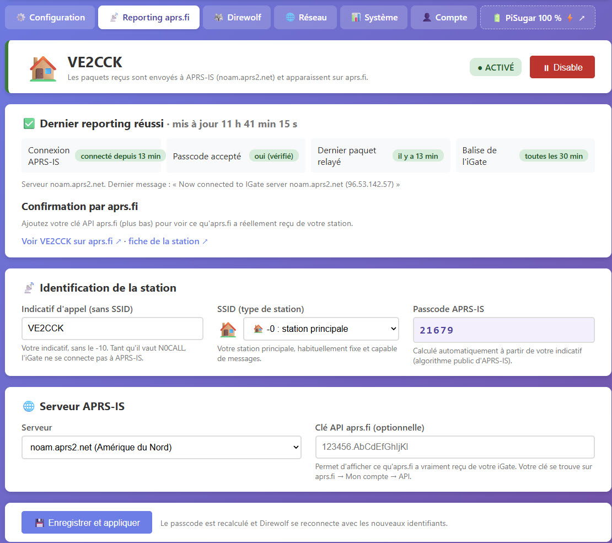

### Direwolf

Direwolf est le logiciel qui décode le signal audio APRS. Cet onglet permet de vérifier qu'il fonctionne bien :

- **Signal en direct** : un vu-mètre à aiguille qui monte quand un paquet est reçu, avec un historique des deux dernières minutes ;
- **Niveau audio et paquets décodés** : indiquent si le réglage de réception est correct ;
- **Journal Direwolf** : l'activité de décodage en direct ;
- **Radio (RTL-SDR)** : la fréquence (les fréquences APRS des différentes régions du monde sont proposées), le gain et les options de la clé.

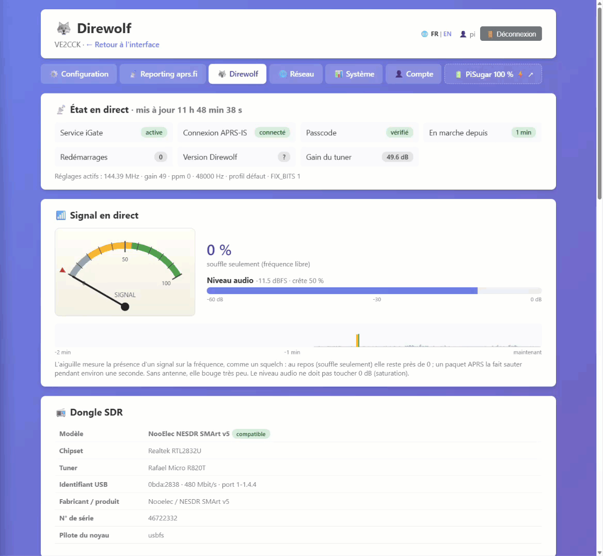

**Trouver le meilleur gain** : le test écoute une minute avec chaque valeur de gain et compte les paquets décodés. Il dure environ 6 minutes, pendant lesquelles l'iGate est arrêté. Lancez-le à une heure où il y a du trafic. À la fin, cliquez sur **Utiliser** à côté du meilleur résultat, puis sur **Enregistrer et appliquer**, et enfin sur **Redémarrer Direwolf**.

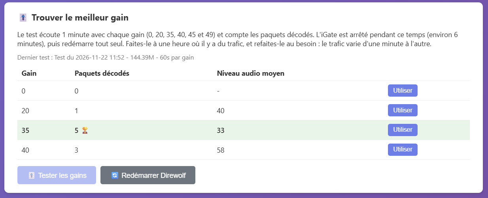

### Réseau

Cet onglet affiche l'état des cartes réseau et gère des **profils réseau** enregistrés.

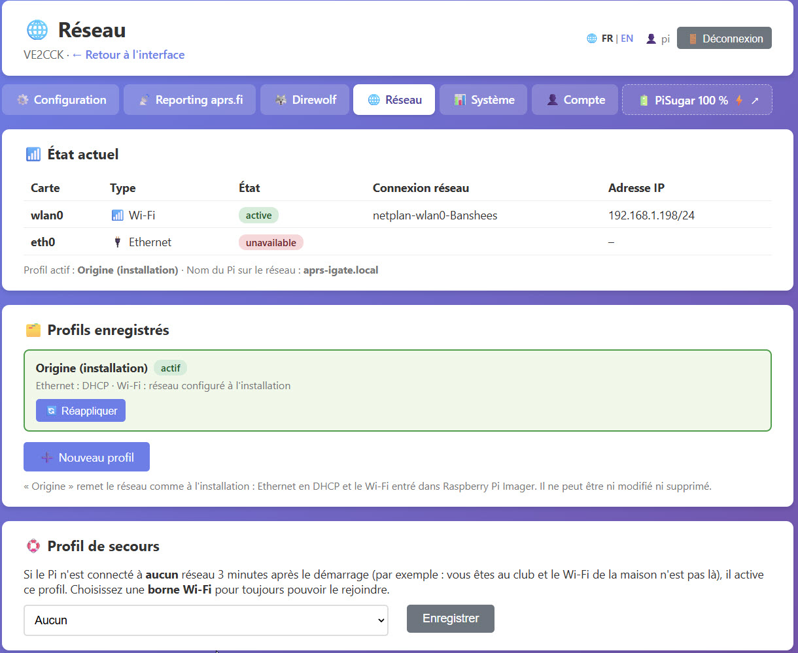

- Le profil **Origine** correspond au réseau configuré dans Raspberry Pi Imager. Il ne peut être ni modifié ni supprimé, et permet toujours de revenir à la configuration de départ.
- **Nouveau profil** permet de créer, par exemple, un profil *Présentation au club* où le Pi devient une **borne Wi-Fi** à laquelle les visiteurs se connectent. L'interface est alors accessible à l'adresse http://10.42.0.1. Sans câble Ethernet relié à Internet, l'iGate continue de recevoir et d'afficher les paquets localement, mais ne peut pas les envoyer à aprs.fi.
- Après l'activation d'un profil, vous avez **5 minutes** pour cliquer sur *Garder cette configuration* depuis le nouveau réseau. Sinon, le Pi revient automatiquement au profil précédent.
- Le **profil de secours** s'active si le Pi n'est connecté à aucun réseau 3 minutes après le démarrage. Choisissez-y une borne Wi-Fi pour toujours pouvoir rejoindre le Pi.

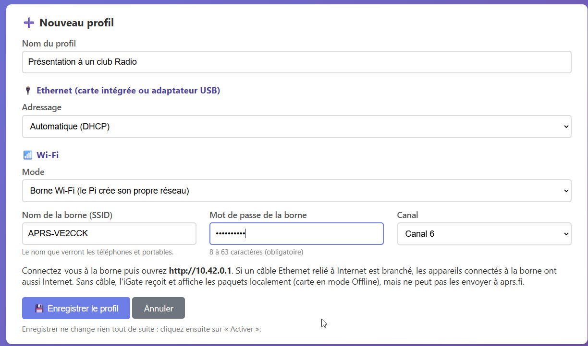

### Système

Les mesures d'utilisation du Raspberry Pi : processeur, mémoire, espace disque, température et processus. Elles montrent que le Pi Zero 2W suffit largement pour ce projet.

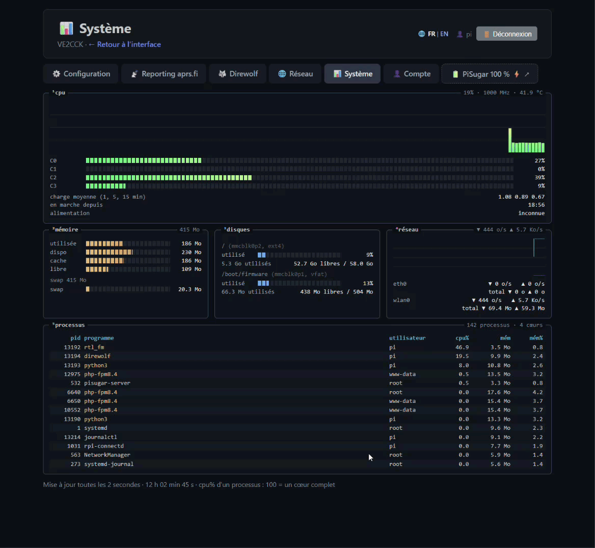

### Compte

Pour changer le nom d'utilisateur et le mot de passe administrateur.

### PiSugar

Cet onglet apparaît seulement si le logiciel du PiSugar est installé et détecté. Il ouvre directement l'interface du PiSugar (niveau de batterie, charge) ; il n'y a pas d'autre intégration avec l'iGate.

## Annexe A : PiSugar 3

Le PiSugar 3 est une batterie qui se fixe sous le Raspberry Pi et le rend autonome en cas de panne de courant.

### Installer le logiciel

Prérequis :

- le PiSugar 3 est fixé au Raspberry Pi ;
- le Pi est connecté à Internet ;
- l'interface I2C est activée : `sudo raspi-config`, puis *Interface Options*, *I2C*, *Oui*.

Installation :

```
wget https://cdn.pisugar.com/release/pisugar-power-manager.sh
bash pisugar-power-manager.sh -c release
```

L'interface de gestion de la batterie est ensuite accessible à l'adresse http://adresse-du-pi:8421, ainsi que par l'onglet PiSugar de l'administration.

### Mettre à jour le micrologiciel

Avant de commencer, chargez complètement la batterie. Le script arrête lui-même le service `pisugar-server` pendant la mise à jour.

```
curl https://cdn.pisugar.com/release/PiSugarUpdate.sh | sudo bash
```

Confirmez si le script le demande, puis attendez la fin : il met à jour le micrologiciel et redémarre le service.

### Mise en marche

La protection contre les appuis accidentels est activée par défaut : pour allumer, faites un appui court suivi d'un appui long sur le bouton d'alimentation. Le petit bouton rond de la carte sert à réinitialiser le matériel ; ce n'est pas un bouton de mise en marche.

La description complète de la carte (boutons, broches, connecteurs) se trouve dans la documentation officielle : https://github.com/PiSugar/PiSugar/wiki/PiSugar-3-Series

## Annexe B : transférer des fichiers avec WinSCP (Windows)

WinSCP permet de copier des fichiers entre votre PC et le Pi, par exemple pour récupérer une sauvegarde.

1. Téléchargez WinSCP (https://winscp.net) et installez-le.
2. Au lancement, choisissez le protocole SFTP, entrez `aprs-igate.local` (ou l'adresse IP du Pi), l'utilisateur `pi` et votre mot de passe, puis cliquez sur *Connexion*.
3. Votre PC s'affiche à gauche et le Raspberry Pi à droite. Glissez les fichiers d'un côté à l'autre.

## Annexe C : dépannage

| Problème | Solution |
|---|---|
| Mot de passe administrateur oublié | En SSH : `sudo aprs-admin-passwd` |
| Clé SDR absente dans l'État du système | Vérifiez le câble adaptateur micro-USB. Si un concentrateur USB est utilisé, préférez un modèle alimenté. |
| Aucun paquet décodé | Vérifiez l'antenne et la fréquence dans l'onglet Direwolf, puis lancez le test du gain. |
| La station n'apparaît pas sur aprs.fi | Vérifiez l'indicatif et la section *Dernier reporting réussi* de l'onglet Reporting. |
| Plus d'accès au Pi après un changement de réseau | Attendez 5 minutes : sans confirmation, le Pi revient au profil précédent. |
| Page « Welcome to nginx » | Relancez `sudo ./install.sh --skip-upgrade` dans le dossier du projet. |
